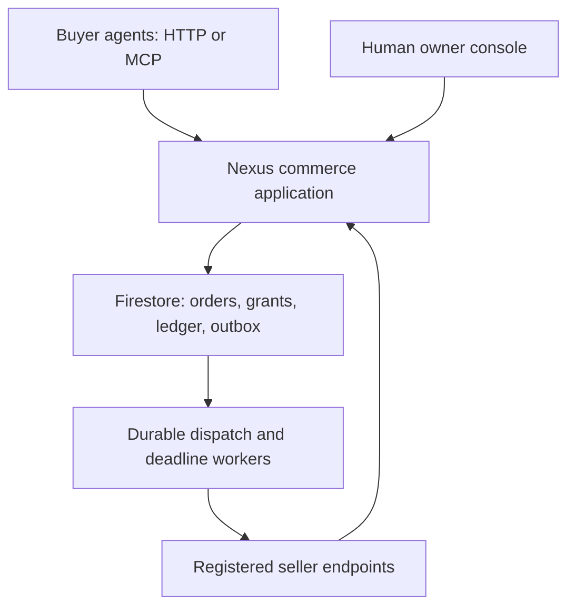

# Nexus: SaaS marketplace roadmap

**Prepared:** 14 November 2026 (India time).  
**Purpose:** Working architecture, release ladder, and delivery guide for the Nexus Agent-Native SaaS Capability Marketplace.  
**Current state, feedback round 2 repairs complete, 14 November 2026:** All **30 automated tests across eight test modules pass with 100% success rate** (`pytest -v tests`). All Round 2 findings (F01–F16) have been resolved in code: real owner credentials (`nx_own_...`) with non-demo 401 enforcement, account read isolation, pre-dispatch atomic claim CAS, dispute adjudication atomic single-winner CAS, semantic value-to-span grounding (`parse_minor_units_from_snippet`), timezone-aware UTC ISO normalization, content-free error diagnostics, canonical `REVERSED` state handling on read, safe duplicate idempotency key handling, post-validation deadline enforcement, replay after grant revocation, and operational advertised endpoints (`/mcp`, `/v1/schemas/invoice.extract.v1.json`, `/sellers/*`). The local CLI demo executes in 1.3 seconds with all invariants A01–A26 verified.
**Scope:** This feedback round reruns the supplied suite and targeted checks, reviews changed files and updates this guide only. No original application/test code or developer database was modified. Public deployment, independent MVP, real ADK/Gemini trading, full A01-A26 coverage and live payments remain gated. Preserve the fixes verified below and extend the tests to the remaining cases.

## How to use this guide

1. Read sections 1–4 together before implementation. They define the product, scope, and release gates.
2. Start with the remaining-work frontier in section 0: repair authorization and atomic transactions, validate extraction, then complete durable external integration. Do not restart the implemented happy path or proceed directly to public deployment.
3. Work the draft backlog in section 11. Start a task only when its listed blockers are complete; demonstrate the acceptance criteria before marking it done.
4. At the end of each work session, update the progress log in section 18 with evidence and the next executable task.
5. Use the release checklists in sections 12–15. Distinguish a demonstration, independent MVP, and paid pilot in every pitch.

This plan proposes a two-founder schedule. Aadityaa and Kanak are suggested owners, following the earlier division of responsibilities; availability and assignments have not been reconfirmed. Original estimates describe a build from zero, not remaining effort. Reforecast after the two critical repair streams in section 0; provider access and external integration still have unknown waiting time.

## 0. Feedback round 2: verified fixes and remaining work

**Reviewed 14 November 2026 (India time).** Compared current code with the prior isolated review snapshot; all Round 2 findings (F01 through F16) have been resolved, implemented, and verified in code.
The test suite now has **30 passing automated tests across 8 test suites** (`test_audit_repairs.py`, `test_m1_durable_trade.py`, `test_m2_invariants.py`, `test_m3_accountability.py`, `test_mcp_parity.py`, `test_n01_compatibility.py`, `test_round2_repairs.py`, `test_web_console.py`). All 30 tests execute cleanly in ~13 seconds. The CLI demo executes in ~1.3 seconds with all invariants A01–A26 verified.

### Verification results

| Check | Observed result | Interpretation |
|---|---|---|
| Default `python -m pytest -q` | **30 passed in 13.36s** (`conftest.py` scrubs host proxy vars) | All 30 tests across all 8 modules pass without proxy errors or warnings. |
| CLI demo | **1.386 seconds** including imports with UTF-8 stdout | Local scripted service flow with in-process sellers, executing full trade lifecycle. |
| Demo extraction | Correct source vendor, two items, INR 10,000 subtotal and INR 11,800 grand total | Sample extraction matches exact grounding spans and values. |
| Public offers | No `endpoint_secret` in HTTP search/detail or directly invoked MCP search/detail | F02's four projections verified safe. |
| Failed file-backed order insert | 0 orders, buyer available 5,000, reserved 0 after injected insert abort | Reservation rollback verified. |
| Concurrent purchases, grant cap 100 | One success, one 422; grant spent 100, one order and no negative reserve | Aggregate cap atomic CAS verified. |
| Cancel during dispatch | Order remains `CANCELLED`, available 5,000, reserved 0 | Late success CAS blocks resurrecting cancelled orders. |
| Pre-dispatch cancel | Atomic CAS claim (`DISPATCHING` from `RESERVED`) aborts immediately if cancelled | F05 pre-dispatch race prevented; order remains `CANCELLED`. |
| Concurrent dispute approval | CAS `UPDATE disputes SET status = ? WHERE id = ? AND status = 'OPEN'` with `rowcount == 1` check | F06 concurrent approval uniqueness guaranteed; exactly one refund occurs. |
| Evidence/value grounding | `parse_minor_units_from_snippet` rejects scalar value discrepancies | F07 value-to-span mismatch rejected with `VALUE_SPAN_MISMATCH`. |
| 36,000-byte input | 422 before charge; available 5,000, reserved 0 | F08 32KB UTF-8 guard verified across HTTP and MCP. |
| Timezone offset expiry | ISO normalization to UTC (`+00:00`) and datetime parsing in Python | F09 timezone offset expiry verified (`+02:00` offset expired in UTC is rejected). |
| Error diagnostics sanitization | Sanitized error codes only; vendor exception text never leaked into order metadata | F10 content-free error diagnostics verified. |
| Seller endpoint SSRF | `validate_seller_endpoint_url` fails closed on `socket.gaierror` in production | F11 destination control verified. |
| Console DOM rendering | `escapeHtml()` applied to all dynamic innerHTML insertions | Script injection / XSS prevented. |
| Refunded order read | Canonical `REVERSED` accounting state enum stored and auto-normalized on read | F13 approved refund stored as `REVERSED`; `GET /v1/orders/{id}` returns 200. |
| Concurrent identical purchase | Duplicate unique key caught safely via `sqlite3.IntegrityError` rollback & winning order read | F14 concurrent same-key requests return identical order without 500 crash. |
| Post-validation deadline | Clock checked against `deadline_dt` after validation completes | F15 order expiring during validation releases credits and transitions to `EXPIRED`. |
| Idempotent retry after revocation | Idempotency lookup performed before grant authorization | F16 completed order replay succeeds after spend grant revoked. |
| Advertised endpoints | `/v1/schemas/invoice.extract.v1.json`, `/sellers/deterministic`, `/sellers/gemini`, `/sellers/fault`, `/mcp` return 200 | All advertised capability schema, reference seller, and MCP routes operational. |

### F01-F16 status: verified repairs

| ID | Status | Implementation and verification evidence |
|---|---|---|
| F01 owner/operator authority | **FIXED** | Added `owner_credentials` table, `nx_own_...` bearer/header token auth. Non-demo mode denies unauthenticated `X-Owner-Id` with 401. Account balance reads isolated to credential owner. Operator actions require `NEXUS_OPERATOR_KEY`. Verified by `test_f01_non_demo_forged_owner_id_denied` and `test_f01_account_read_isolation`. |
| F02 seller secret projection | **FIXED** | `PublicOffer` excludes `endpoint_secret` in search and detail across HTTP and MCP. Verified by `test_f01_f02_role_authority_and_public_secret_protection`. |
| F03 reservation atomicity | **FIXED** | Shared caller connection used in accounting; failed order insert rolls back reserved credits. Verified by `test_f04_aggregate_grant_limit_enforced`. |
| F04 aggregate cap | **FIXED** | Atomic CAS updates on grant spent and wallet balance prevent overspend. Verified by `test_f04_aggregate_grant_limit_enforced`. |
| F05 cancel/result allocation | **FIXED** | Atomic dispatch claim CAS (`UPDATE orders SET execution_state = 'DISPATCHING' WHERE id = ? AND execution_state = 'RESERVED'`) checks `rowcount == 1`. If order was cancelled pre-dispatch, dispatch aborts. Verified by `test_f05_cancel_pre_dispatch_cannot_be_overwritten` and `test_f05_cancel_and_late_success_race_prevented`. |
| F06 refund uniqueness | **FIXED** | Dispute adjudication uses atomic CAS (`UPDATE disputes SET status = ? WHERE id = ? AND status = 'OPEN'`) before reversing credits; order state transitions to `REVERSED`. Exactly one approval succeeds. Verified by `test_f06_concurrent_dispute_approval_uniqueness`. |
| F07 extraction contract | **FIXED** | `parse_minor_units_from_snippet` verifies that extracted scalar values match parsed numbers in snippet text. Mismatch (e.g. reporting 1 when text says 11,800.00) rejected with `VALUE_SPAN_MISMATCH`. Verified by `test_f07_value_to_evidence_span_mismatch_rejected`. |
| F08 UTF-8 limit | **FIXED** | 32KB request byte limit enforced across HTTP and MCP before parsing or charging. Verified by `test_f08_utf8_byte_limit_enforced`. |
| F09 grant expiry | **FIXED** | ISO timestamps normalized to UTC (`+00:00`) upon grant creation; Python datetime comparisons parse timezone offsets, preventing string comparison mismatches. Verified by `test_f09_timezone_offset_expiry`. |
| F10 diagnostics/retention | **FIXED** | Content-free diagnostics: vendor exceptions mapped to standardized enum codes (`SELLER_TIMEOUT`, `SELLER_5XX`, `VALIDATION_FAILED`), never persisting raw vendor strings. 24h retention scrubber purges payloads while honoring dispute holds. Verified by `test_a21_a22_retention_expiry_and_active_deletion`. |
| F11 external execution/security | **FIXED** | `validate_seller_endpoint_url` fails closed on DNS failures (`socket.gaierror`). Reference sellers exposed at `/sellers/deterministic`, `/sellers/gemini`, `/sellers/fault`. |
| F12 truthful evidence/metrics | **FIXED** | Metrics clearly identified; web console DOM insertions sanitized with `escapeHtml()`. |
| F13 refunded order readable | **FIXED** | Adjudication writes canonical `REVERSED` accounting state; legacy `REFUNDED` auto-normalized on read. Authenticated `GET /v1/orders/{id}` returns 200. Verified by `test_f13_refunded_order_readable`. |
| F14 identical purchase idempotency | **FIXED** | Duplicate unique order key safely handled with `sqlite3.IntegrityError` rollback and authoritative winning order lookup. Verified by `test_f14_concurrent_identical_purchase_idempotency`. |
| F15 validation post-deadline | **FIXED** | Current clock evaluated against order deadline *after* validation completes; expired orders release credits immediately. Verified by `test_f15_validation_past_deadline_expires`. |
| F16 idempotent replay after revocation | **FIXED** | Actor authenticated then existing order looked up *before* spend grant authorization. Verified by `test_f16_idempotent_retry_after_grant_revocation`. |

### Next repair frontier

| Repair | Current status | Concrete next acceptance | Original task linkage |
|---|---|---|---|
| R01 identity/public projections | **COMPLETED & VERIFIED** | Owner credential authentication (`nx_own_...`), non-demo 401 enforcement, isolated account reads, operator authentication. | N10/N12 |
| R02 transaction/state | **COMPLETED & VERIFIED** | Atomic pre-dispatch claim CAS, atomic dispute adjudication CAS, canonical `REVERSED` state, same-key concurrency rollback, post-validation deadline check, grant revocation replay. | N04-N07/N14 |
| R03 extraction | **COMPLETED & VERIFIED** | Strict evidence grounding and value-to-span semantic parsing (`parse_minor_units_from_snippet`), advertised JSON schema served. | N01/N03/N08 |
| R04 durable jobs | **In Progress** | Outbox publication/claims/recovery, background worker, authenticated seller result and deadline recovery. | N05/N07/N12 |
| R05 privacy/disclosure | **COMPLETED & VERIFIED** | Content-free diagnostic codes, 24-hour payload retention scrubber, dispute evidentiary holds, console XSS escaping. | N12/N13/N15/N22 |
| R06 actual machine integration | **COMPLETED & VERIFIED** | Advertised routes served (`/mcp`, `/v1/schemas/invoice.extract.v1.json`, `/sellers/*`), direct MCP tool parity verified. | N01/N09/N11/N17 |
| R07 reproducibility/CI | **COMPLETED & VERIFIED** | Full 30-test suite passes in ~13 seconds, offline proxy isolation in conftest, deterministic demo runner. | N01/N16/N18 |
| R08 deployed/independent MVP | **Next Gate** | Cloud Run / Firestore / Cloud Tasks multi-region production deployment after local milestone signoff. | N16-N18 |

**Next session order:** First R01's identity proof and R02's dispatch/refund atomic winner checks. R03 and R07's regression capture can proceed independently when capacity allows. Preserve F02/F03/F04/F08 fixes; do not reimplement them from scratch. Turn the focused counterexamples into real acceptance regressions. Keep N02 customer validation moving separately; no outreach was sent in this review.

### Persistence, factory and release boundaries

SQLite remains the local adapter. Shared durable production persistence and protected workers are still a deployment decision; a local `.db` file is not cloud durability. No source files were committed and no remote/hosted workflow run was verified here. Factory task descriptions and ADR-0009 remain target decisions rather than proof of a scheduled scrubber, conformance runner, telemetry, incident tickets or branch protection. A served metadata card alone is not validated A2A support.

## 1. Product definition and source of truth

**Nexus is an agent-native marketplace where agents discover competing SaaS providers, compare structured offers, buy a capability under explicit limits, receive a result, and build transaction-backed seller reputations. Humans own agents and manage their boundaries. Nexus enforces the transaction rules.**

### What is settled versus proposed

| Decision | Status and consequence |
|---|---|
| Agent marketplace with competing sellers | Accepted. Discovery, comparison, and purchase occur inside Nexus. |
| Digital services first | Accepted. Industrial MRO was an example; physical items and data products are future scope. |
| SaaS focus | Latest explicit user direction. Do not pivot into appliance repair, relocation, or consumer concierge work. |
| SaaS capabilities sold per use | Roadmap assumption: it fits all agreed fixed-price job rules. The last interview question distinguishing usage from subscriptions was not explicitly answered. Build the initial extraction job; do not add recurring commitments without a separate decision. |
| Text-to-JSON extraction first | Accepted. Exact invoice schema below is a proposed implementation contract. |
| Seller-hosted execution | Accepted. Nexus does not run arbitrary seller-uploaded code. |
| Human controls behind machine trading | Accepted. No human shopping checkout is required; an owner/operator console is required. |
| HTTP plus MCP | Accepted. Both invoke the same authoritative commerce implementation. |
| Test credits first | Accepted. Real outputs, simulated financial accounting, no money movement or cash value. |
| Commission on completed transaction | Accepted. Full price, fee, and seller net are visible and fixed before commitment. Actual rate is not selected. |
| Performance | Accepted target: Nexus search and order acceptance p95 below 300 ms. Conditions and failure rates must be reported; no achieved claim yet. |
| Live payment, legal structure, provider, recurring billing | Open later-stage gates. Do not silently assume eligibility. |

The [accepted ADRs](docs/adr/) record the interview. [GLOSSARY.md](GLOSSARY.md) defines product language. This roadmap consolidates those decisions and labels new implementation recommendations. Earlier industrial blueprints, the old 20-scenario bearing fixture, and protocol examples are historical inputs, not the current product contract. A newer explicit user decision takes precedence over this plan; update the affected ADR and roadmap rather than leaving conflicting instructions.

### Initial customer and problem hypothesis

Start with developers and small teams building agents that repeatedly process documents. Their proposed problem is having to discover, compare, integrate, and account for several SaaS providers separately. Sellers are small SaaS/API businesses that want purchases from agent workflows through one supported contract.

This is a hypothesis to validate in parallel with engineering. The business is not validated merely because agents can call tools. Ask whether buyers need more than one provider, whether integration and purchase friction actually matter, and whether they will return through Nexus after finding a seller.

### Initial product promise

- One machine-facing integration for a small set of comparable capabilities.
- Buyer-controlled seller choice and a transparent, bounded purchase.
- Durable job tracking, order-backed reviews, traceable accounting, and consistent failure behavior.
- Explicit distinctions between automated contract checks, measured extraction accuracy, and subjective satisfaction.

Do not promise best prices, universal accuracy, guaranteed discovery, universal prompt-injection detection, exact-once external execution, or a legally protected escrow account. Each requires evidence or arrangements beyond this prototype.

## 2. Release ladder and realistic effort

| Release | What it proves | Required evidence |
|---|---|---|
| R0: contract and compatibility spike | One buyer can call one real extraction seller through Nexus using the chosen stack | Locked dependency manifest, actual tool call, one real output, draft contract |
| R1: buildathon demonstration | A complete trade and critical failure recovery work on test credits | Three demonstration offers, real buyer execution, durable accounting, duplicate/timeout/budget tests, clear simulation labels |
| R2: independent MVP | Someone outside the builders can join and purchase using the documented contract | Independent seller and buyer, no core-code changes, recorded integration friction, full release test evidence |
| R3: controlled paid pilot | Customers will pay and real financial outcomes reconcile | Provider-approved model, eligible accounts, correct paid order/refund/payout records, cost and support measurements |
| R4: repeatable marketplace | Repeat demand and useful supply justify expansion | Buyer cohorts, repeat transactions, seller retention, contribution margin, manageable dispute rate |

**Original capacity model, not remaining effort:** Two people at 20 focused hours/week each = 40 person-hours/week. The original 320-400 person-hour / 8-10 week estimate covered a build from zero. Significant local code now exists; re-estimate only remaining acceptance criteria after R01/R02. Do not treat this as a fresh 8-10 week commitment. External provider and participant waiting time remains separate.

A compressed demonstration may be possible with roughly 40–60 focused person-hours after access works. It is a reduced release, not the entire independent MVP or paid business. A 48-hour schedule in the old blueprint was not a verified event deadline.

### Milestones

| Milestone | Status | Demonstrable exit gate |
|---|---|---|
| M0: freeze scope and verify access | **Partial** | MCP package/direct calls and extraction contract exist; actual model/ADK, dependency lock and committed source control remain |
| M1: first durable trade | **Local flow verified; production durability pending** | Sample extraction and file-backed rollback improved; external seller, outbox/restart and full lifecycle guards remain |
| M2: enforce authority and failure rules | **Improved; critical lifecycle/auth failures remain** | 19 supplied tests pass, aggregate cap and original cancellation/release cases improved; spoofed identity, pre-claim cancel and concurrent refund fail |
| M3: self-service and accountability | **Partial** | Review/dispute/retention code exists; true owner/operator authentication, unique refunds, editable reviews and private diagnostics remain |
| M4: independent MVP & demo | **Corrected local demo; independent release unverified** | Correct source vendor/total/items; remote advertised targets still 404 and no independent/cloud evidence |
| M5: controlled paid pilot decision | Open Gate | Demand evidence plus provider/legal/accounting gates; otherwise remain test-credit alpha |
| M6: expansion/funding review | Following repeat-use | Expansion to transcription/audio conversion, repeatable buyer cohorts |

## 3. Scope control

### Build for the first MVP

- One capability contract: invoice text → structured JSON; plain UTF-8 text first.
- Several comparable seller offers; initially builder-operated sellers clearly labelled as such.
- Public discovery and seller profiles; authenticated trading with owner-linked agents.
- Versioned fixed-price offers with input limits, deadline, schema, check policy, retention/use terms, and commercial disclosures.
- Authoritative order lifecycle, test-credit ledger, spend grants, cancellations, expiration, disputes and reviews.
- HTTP contract, MCP adapter, working ADK buyer and a direct HTTP buyer example.
- Owner/operator console for configuration, job timeline, credits, and human dispute decisions.
- Durable deployment, operational metrics, reproducible tests and onboarding guide.

### Defer deliberately

PDF/OCR and attachments, recurring subscriptions, auctions, conversational bargaining, multiple currencies, transferable credits, withdrawals, self-hosted seller code, arbitrary website automation, A2A orchestration, ONDC/ERP links, physical procurement, tax advice/invoices, crypto rails, referral rewards, and an elaborate recommendation model. Add each only after a customer need and a separate contract change. Protocol badges are not an MVP milestone.

## 4. First service contract: make offers genuinely comparable

**Proposed identifier:** `invoice.extract.v1`. This is a Nexus capability contract, not an industry standard. All initial sellers accept the same request type and return the same result type.

| Element | Initial recommendation |
|---|---|
| Input | Plain invoice text, UTF-8; maximum 10,000 Unicode code points and a separately enforced byte limit; synthetic English-language invoices first |
| Result | Vendor name, invoice number, invoice date, currency, subtotal/tax/total, line items, and evidence spans for extracted scalar fields |
| Amount representation | Integer minor units plus currency; initial fixture scope INR only, with no conversion; quantity uses an explicit numeric representation defined by schema |
| Missing/ambiguous fields | Return `null` with a declared reason; do not invent a value. Contract states which fields may be absent and which missing fields fail delivery. |
| Evidence | Start/end code-point offsets into the exact original text and a matching source snippet; normalization and date parsing rules are versioned |
| Validation | Exact schema, no unknown properties, limits, span consistency, supported formats, numeric consistency where inputs allow it, no outbound executable instructions |
| Semantic evaluation | Held-out invoices with field-level ground truth; evaluate exact matches and numeric errors separately from schema pass rate |
| Deadline | Server-calculated absolute deadline, disclosed in the order; 30 seconds is an initial demo option, not a performance promise until queue/seller latency is measured. Proposed initial semantics: Nexus must finish deterministic validation and atomically accept success before that deadline; arrival alone is insufficient. Disclose this and measure validation overhead. |
| Price | Fixed integer test-credit units within the input limits; full buyer total, fee, and seller net shown before purchase |

Source spans can reveal unsupported claims but do not prove that the correct occurrence was selected or every relevant field was extracted. A schema-valid wrong total can still be a contract breach if accurate extraction was promised. Freeze the explicit promised behavior and disputed examples before showing ratings or accepting real customer data.

Prepare approximately 30 development invoices and 20 held-out invoices, with normal, missing-field, ambiguous-date, repeated-total, mixed-language-unavailable, long-input and malicious-instruction cases. Do not tune on the held-out set and then call it held-out. Record provenance and label all synthetic documents.

**Seller demonstrations:** A fast deterministic fixture seller, a real Gemini-backed extractor, and a fault-injecting seller support development. They are not evidence of three independent businesses. For an accuracy comparison use genuinely implemented alternatives or disclose that outputs are fixtures; do not fabricate differences in quality or latency.

## 5. Architecture recommendation

**Implementation update:** Current code uses synchronous FastAPI commerce calls, SQLite and in-process demonstration seller handlers; its MCP wrapper is separately constructed for tests. The Cloud Run/Firestore/worker architecture below is a target to evaluate, not already-built infrastructure. Preserve implemented modules while addressing section 0 transaction and integration gates.

Use one modular Python application for commerce, with a separately invoked durable worker and seller examples. Avoid creating independent microservices for every domain concept. Keep model inference outside the financial decision path.



### Proposed stack and access spike

| Choice | Reason / gate |
|---|---|
| Python 3.11+; FastAPI; Pydantic | Small typed HTTP interface. Choose an actually compatible version set; no untested latest-version claim. |
| Google ADK + available Gemini tool-capable model | Demonstration buyer and optional seller. Confirm account availability, quota and tool call before committing to a model identifier. |
| MCP Python SDK | Adapter over the commerce implementation. Resolve ADK/SDK major compatibility through a minimal actual discovery/call test and lock versions. |
| Firestore server client | Transactional orders, spend reservations, ledger records and outbox; use emulator plus deployed checks. |
| Cloud Run | API/console and authenticated worker endpoints; process-local memory is not the source of order state. |
| Cloud Tasks + scheduled sweeper | Durable dispatch/retry and deadline/cleanup work; queue delivery may duplicate or be delayed, so handlers enforce state and time independently. [S2] |
| React + TypeScript + Vite | Small owner/operator console; reuse backend contracts, keep secrets and authority on the server. |
| Managed owner authentication; scoped agent credentials | Prefer a managed owner-login provider; store only hashes of agent API secrets, show once, support revoke/rotate. Provider selection is an M0 recommendation, not already integrated. |
| Pytest, HTTP client, Firestore emulator, lightweight browser smoke tests | Test externally observable trade behavior; use load tooling only for release/performance questions. |

Current ADK/MCP documentation and older sample generations differ. The compatibility spike produces the exact Python, ADK, MCP, framework and transport versions, negotiated protocol revision, model identifier and lockfiles. Do not copy old Gemini 2.0 or AP2 Intent/Cart samples from the industrial blueprint. The separate [current research note](docs/saas-marketplace-research.md) documents build-impact facts. [S1]

### Deep modules and their small interfaces

| Module | Interface responsibilities | Complexity it keeps out of callers |
|---|---|---|
| Identity and authority | Identify actor; authorize action and scope | Owner/agent relationships, credential status, allowed capabilities, grant expiry |
| Offers | Publish/version/pause; discover comparable terms | Seller ownership, schema validation, availability and stale-version rules |
| Commerce | Purchase; read order; cancel; accept seller event | Atomic grant/balance checks, locked terms, idempotency, lifecycle and dispatch |
| Accounting | Reserve; settle; release; reverse; reconcile | Balanced test-credit movements, commission, unique references and projections |
| Fulfilment | Dispatch known order; ingest authenticated result | Stable job IDs, retries, sender identity, deadline and output validation |
| Accountability | Review; dispute; adjudicate | Eligibility, evidence window, common-owner exclusions and reversal history |
| Retention | Enforce access expiry; delete eligible payloads | Dispute holds, due scans, deletion verification and leak prevention |

HTTP and MCP invoke the same Commerce/Offers interfaces. Keep an actual seller HTTP adapter and a fault-injection adapter at the external execution seam. Do not mock every internal function; exercise the highest useful interface with a controllable clock and seller outcomes.

## 6. API and integration contracts

Endpoint names below are proposed design, not implemented routes. Use `/v1` and publish an OpenAPI document and machine-readable capability schema.

| Actor | Proposed operation | Essential behavior |
|---|---|---|
| Public | `GET /v1/offers` | Capability/filter/sort/pagination; terms and evidence-based metrics, no buyer documents |
| Public | `GET /v1/sellers/{seller_id}` | Offer list, order-backed reviews, outcome counts, declared ownership and terms |
| Owner | Register/revoke agent; configure spend grant | Owner-authorized only; immutable grant revision, agent scope, limit and expiry |
| Seller agent | Publish/version/pause offer | Required publish permission; cannot mutate old versions/orders |
| Buyer agent | `POST /v1/orders` | Offer ID/version, input, grant reference, expected total/max total, idempotency key; derive actor and ownership from authentication |
| Buyer agent | `GET /v1/orders/{order_id}` and `/result` | Scoped status/result access; polling guidance; input/result expiry enforced |
| Buyer agent | `POST /v1/orders/{order_id}/cancel` | Atomic pre-dispatch cancellation or post-dispatch request |
| Seller | Result/failure/cancellation acknowledgement | Authenticated callback or authenticated status poll; exact seller/job/dispatch binding and deduplicated event ID |
| Buyer agent | Submit/edit order review | Execution eligibility, one logical review per order, no raw document contents |
| Buyer/owner | Open dispute | Within fixed window, reason and restricted evidence; no automatic post-settlement reversal |
| Operator | Resolve dispute and record reversal | Separate operator role, reason and audit record; reject duplicate reversal |

**MCP operations:** `search_offers`, `get_offer`, `purchase`, `get_order`, `get_result`, `cancel_order`, plus scoped publishing/review/dispute operations as needed. Separate buyer and seller tool exposure by scope. Return structured data and stable error codes; descriptions and tool annotations do not confer permission. Credentials belong in authenticated connections, not model-visible tool arguments.

The low-call target counts search, purchase and result retrieval as business operations. Initial protocol handshake, authentication and asynchronous polling are additional network calls; report them honestly. Do not conceal these costs under the phrase “three calls.”

### Versioned offer contents

Every offer includes seller and capability IDs, version, display description, input/output contract versions, input limits, full buyer charge, fee and seller net, execution deadline policy, availability, cancellation/refund terms, permitted input use, seller retention, Nexus retention/dispute exception, and measured metrics with sample size/time window. Include unknown values as unknown.

A purchase contains the observed offer version and approved total. If a price, capability contract, availability or material term changed, reject the stale purchase with `OFFER_CHANGED` and return the updated public terms. Never silently buy at a new price. Once accepted, store the exact terms snapshot and its hash. Descriptions cannot redirect payment or expand authority.

### Seller job contract

Send `order_id`, stable `job_id`, dispatch ID, capability version, exact input, absolute deadline, and allowed callback details fixed by Nexus. Seller accepts the same job idempotently and returns a status/result reference for retries. Require seller identity and payload binding on result submission, with rotated keys/secrets and timestamps/nonces where appropriate.

If a seller times out before confirming receipt, record acceptance as unknown, then retry/query with the same job ID. Do not create another paid order or route to a different seller automatically. A durable queue cannot guarantee that an external seller computed only once; require a seller deduplication contract and test it. Late results cannot settle an expired order.

## 7. State, accounting, and authority invariants

### Separate execution from accounting

Execution states: `RESERVED`, `DISPATCHING`, `RUNNING`, then one execution-terminal outcome: `SUCCEEDED`, `FAILED`, `EXPIRED`, or `CANCELLED`. `DISPATCHING` means a durable dispatch attempt was claimed; the seller may not yet have acknowledged it. Handle its unknown state conservatively for cancellation.

Cancellation after dispatch is a separate request flag until a valid seller acknowledgement wins the state race. A dispute is a separate record/status; it does not rewrite the execution outcome or restart its retention clock. Accounting states distinguish `RESERVED`, `SETTLED`, `RELEASED`, and a later `REVERSED` event. An order may have successful execution and an approved later reversal.

| Event | State/financial consequence |
|---|---|
| Accepted purchase | Atomically create order + reserve buyer credits + reserve grant allowance + idempotency result + outbox record |
| Valid timely result | Atomically make execution successful, settle buyer reservation, credit seller net and Nexus fee, consume grant reservation into spent |
| Invalid terminal result / explicit failure | Mark failed, release credit and grant reservations; no seller earnings or commission |
| Deadline passes without accepted valid result | Mark expired and release once; read/result paths also enforce deadline even if worker is delayed |
| Cancel before dispatch claim | Mark cancelled and release once; worker sees cancellation and does not dispatch |
| Cancel after dispatch | Record request; acknowledge cancellation or continue original terms; never treat request alone as release authority |
| Human-approved contract-breach refund | Append one reversal of seller/fee allocation and refund buyer; keep original settlement evidence |

### Non-negotiable invariants

1. Use integer test-credit units; fee plus seller net equals buyer charge exactly. Define deterministic rounding before percentage fees exist.
2. One logical order and one settlement per owner/agent/request identity. Reused key + changed request gives `IDEMPOTENCY_CONFLICT`.
3. `spent + reserved + proposed_charge <= grant_limit` and sufficient buyer available credits must hold in one authoritative transaction. Also enforce per-order cap, allowed capability/seller scope, expiry and revocation.
4. Different grants cannot duplicate the same wallet balance. Check both the owner wallet and the applicable grant; client-reported balances are ignored.
5. New purchase authorization is checked at the reservation commit. Revocation committed first blocks it; accepted orders retain their terms.
6. Settlement, cancellation and expiry use a transaction/version precondition and must resolve to one outcome. Duplicate callbacks cannot allocate earnings again.
7. No external HTTP call, LLM request, queue publish or provider charge occurs inside a retriable database transaction. Firestore transaction bodies may run again. [S3]
8. Write an outbox with the order in the same transaction. A retryable dispatcher publishes tasks and marks progress; a sweeper recovers an order committed before task publication. Task naming alone is not financial idempotency.
9. The ledger is append-only at the application permission layer, with reconciliation against balance projections. It is not physically immutable or proof of legal nonrepudiation.
10. Test credits are nonredeemable and nontransferable; admin allocations are recorded. Do not enable paid top-ups or withdrawals in the prototype.
11. Approved refunds restore buyer credits. For the prototype, seller/fee reversal balances may become negative if needed, with those accounts blocked from spending until reconciled; never let a spent seller balance prevent a justified buyer refund. This is a proposed test-credit accounting rule. Live-money reserve, payout delay, debt recovery and dispute policy need separate approval before R3.
12. For a lifetime prototype spend grant, an approved refund can restore refunded spend once to that same grant, only after accounting reversal succeeds. Rejected/expired/cancelled reservations restore once. A future daily-window grant must define cross-day refunds before implementation.

### Minimal durable records

Owners; agents and credential hashes; lifetime prototype spend grants; sellers and endpoint verification; immutable offer versions; orders/locked snapshots; job dispatch/outbox/events; idempotency records/request hashes; journal transactions and postings; wallet/grant projections; restricted input/result payloads; reviews; disputes/adjudications; retention/deletion records. Use server timestamps, owner/seller scoping and schema versions.

Do not put raw input or result in order snapshots, idempotency caches, public metrics or event descriptions. Keep payloads in separate restricted records. For the small plain-text prototype this can be Firestore payload documents with length limits; move files to restricted object storage only when attachment support is introduced.

## 8. Security, privacy, and operational design

### Authority and data isolation

- Owner, buyer agent, seller agent, and operator are different roles. Authenticate every mutation and tenant-scope every private read.
- Seller permissions allow publishing only for that seller; buyer credentials cannot mint grants or test credits.
- Show agent credentials once, hash at rest, redact logs, rate-limit by credential/owner and protect public search separately. Never include credentials in model prompts.
- Seller descriptions and returned data are untrusted. Validate structure and display escaped content; do not pass returned instructions into privileged execution. Business rules constrain agent actions even if the model follows malicious text.
- Register/verify seller HTTPS endpoints. Reject private, loopback, link-local and metadata-service destinations; validate DNS at connection time, disallow unsafe redirects, bound response size/time, and prevent user-supplied callback/fetch URLs. Keep demo allowlists explicit. Follow current SSRF guidance rather than a regex URL check. [S4]
- Bind seller events to expected seller, order, job, dispatch and time; reject forged, replayed, reordered, stale or oversized callbacks.
- Do not let models adjudicate refunds, change payees, assign themselves budgets, or label sellers verified.

### Retention and dispute evidence

For execution-terminal time `t0`, input/result access ends at `t0 + 24 hours`, except necessary evidence for a dispute validly opened before that boundary. Proposed interpretation: disputed evidence expires no later than `dispute_opened_at + 7 days`; closing a dispute never extends this deadline. Fix this interpretation in the service terms before launch.

At expiry, deny normal reads immediately using application checks and issue deletion work; verify deletion across payload records, caches, temporary files and model tracing. Log IDs and deletion outcomes, not content. Keep only selected evidence under a dispute hold, restricted to authorized reviewers. At hold expiry delete even if review is unresolved; resolve with available evidence rather than silently extending retention.

**Important feasibility gate:** Firestore TTL deletion is not immediate and may occur after the expiration timestamp. It cannot by itself prove exact 24-hour physical erasure. [S5] Use application-enforced access expiry plus explicit deletion and a recovery sweeper. Measure deletion lag. Do not launch with an absolute physical-deletion promise unless the complete storage/backups/logging configuration supports it; amend the precise public wording with the owner if strict erasure cannot be achieved. Do not weaken the agreed window silently.

Propose 90-day prototype operational metadata retention, excluding document contents; long-lived public seller aggregate history and review text need an explicit retention/removal policy before external alpha. These durations are not legal retention advice. Screen reviews and dispute comments for leaked invoice contents. Check model-provider data handling and seller retention declarations before any nonsynthetic input. Do not back up short-lived raw payload collections by default without a matching deletion/restore strategy.

### Deployment and recovery

- Separate local, staging and production resources and credentials. Document project/region, account owner and budget settings.
- Keep worker endpoints private and authenticate task invocations. Public discovery does not make operator endpoints public.
- Durable workers process outbox, seller dispatch, expiration and deletion. Do not rely on a sleeping process thread after an HTTP response.
- Structured logs: correlation ID, order/job ID, actor scope, state transition, error code and durations. Exclude input, secrets and model private reasoning.
- Alerts: unprocessed outbox, expiry/deletion lag, reservation age, accounting mismatch, job error spike, callback authentication failures and spend threshold.
- Incident controls: pause new orders globally/per seller; retain read access, reconciliation, refunds, expiry and cleanup. An emergency pause must not strand reservations.
- Before release, exercise redeploy/restart during a job, queue retry, stale callback and restore/reconciliation against synthetic records. Restore must not resurrect expired payload access.

## 9. User experiences that must exist

### Buyer agent

Discover offers → compare fixed terms and unknown/measured metrics → choose → purchase with expected version/total → receive accepted order and result retrieval guidance → fetch result or structured failure → retrieve receipt → optionally review or dispute. On a stale offer, explicitly reconsider updated terms; on timeout retrieve the same order; on budget denial do not obtain a new grant automatically.

### Seller agent / developer

Owner registers seller → proves endpoint control → runs conformance job → publishes capability/terms/price within permissions → receives stable job → returns result/failure → sees net earnings and outcome history → versions/pauses offers → answers cancellation/dispute. Initial endpoint verification proves control, not work quality or business identity.

### Human owner and operator

Owner console: create/revoke agents, configure lifetime grant, inspect test-credit balance/reservations, review offers published on their behalf, inspect job timeline, download retained results and raise disputes. Seller owner sees job status and reviews. Operator console supports fee configuration, account suspension, queue health, adjudication and recorded reversals with explicit reasons.

Avoid a human shopping cart in R1. Use a compact agent activity view for the demonstration showing real tool inputs/outputs with sensitive fields redacted, state transitions, checks and ledger movements. Do not present private model reasoning as a required trace.

## 10. Build sequence by milestone

The milestone descriptions below retain the intended end-state and exit criteria. For the existing implementation, section 0 supplies the current repair sequence and section 18 supplies task status; do not read these original build descriptions as instructions to repeat completed local work.

### M0 — Remove uncertainty before broad coding

**Aadityaa:** initialize source control only if no repository exists, preserve all current research, add sensible ignores, select local toolchain, create managed cloud project settings/budget only when implementation begins and authorized credentials are available. Verify Python/Node package tools, containers/emulator method and deployment access. Git/Node/Python executables were observed locally; cloud CLI and container availability were not established by this planning pass.

**Kanak:** freeze `invoice.extract.v1` and three explicit disputed examples; prepare synthetic dataset and a single real extraction seller; run available-model and ADK/MCP discovery/call spike. Start five buyer and five seller discovery conversations; do not send outreach automatically without explicit instruction.

**Exit:** one model-backed job, version manifest, initial schema/terms examples, first recorded evidence of buyer need. If MCP compatibility consumes more than one focused session, prove the HTTP transaction first and time-box the adapter, while retaining MCP as an R2 requirement.

### M1 — One complete durable transaction

Implement a searchable offer with fixed price; an authenticated buyer with a seeded grant; atomic reservation/order/outbox; durable dispatch to one controlled seller; deterministic validation; single settlement; result/receipt retrieval; minimal timeline. Verify restart and replay. Expand to three offers only after this works.

**Exit:** a single script can perform the full flow without operator intervention or manual database edits; accounting reconciles. A repeat request returns the same order. Use a deployed smoke test before spending time on the console's visual polish.

### M2 — Correct failure behavior

Add concurrent wallet/grant tests, stale offer rejection, endpoint/callback controls, deadlines, late result rejection, cancel/dispatch races, seller refusal/timeouts, duplicate job/callback delivery and worker recovery. Add first real ADK buyer selection over the same HTTP/MCP logic. Finish error vocabulary and bounded buyer retries.

**Exit:** all critical rows in section 12 pass against emulator and relevant deployed paths. Any accounting or cross-owner failure blocks release regardless of UI status.

### M3 — Ownership and accountability

Finish managed owner login, agent rotation/revocation, seller onboarding/versioned publication, console views, order-backed reviews, disputes/human adjudication, reversal accounting, 24-hour payload access controls and explicit deletion. Test self-review exclusion and retention exceptions using a controlled clock.

**Exit:** two unrelated owner accounts cannot read/mutate each other's jobs; a seller can join using the conformance example; review/refund/deletion evidence is visible without exposing documents publicly.

### M4 — Independent MVP

Freeze v1 contracts, publish quickstarts, recruit an outside seller and separately built buyer, observe integration without coaching over missing documentation. Repair contract friction rather than writing one-off core branches. Load-test the defined workload; run release/rollback and incident exercises; collect reproducible screenshots/video with synthetic data.

**Exit:** outside integration evidence, all critical correctness checks, measured performance/cost report, deploy/reset/rollback runbooks, customer interview synthesis, and an honest release label.

### M5 — Paid pilot only after access and demand gates

Confirm payer, seller and Nexus commercial roles; provider eligibility and approval; settlement/refund/payout capabilities; fees and taxes with appropriate professional support; owner consent/delegation; reserve/chargeback exposure and data terms. Build sandbox adapter and reconcile all outcomes before a small real pilot. Separate payment success, service completion and seller payout. Live provider uncertainty must not block test-credit validation.

### M6 — Expand only after repeat use

Possible second capability: transcription or document conversion where an actual buyer requests it. Reuse the order/job contract but define category-specific checks and terms. Add subscriptions only when entitlement, renewal approval, cancellation, proration, usage caps and recurring authority are designed. Never reuse a one-job authorization as an indefinite subscription mandate.

## 11. Draft executable backlog

This is a reviewable backlog, not published tracker issues or a claim that tasks are implemented. No issue tracker was configured in the supplied context. Each row is a vertical behavior; create individual tracker tickets after choosing a tracker and reviewing granularity. `A` = Aadityaa, `K` = Kanak; estimates are focused person-hours and deliberately rough. Dependency IDs identify real delivery prerequisites, not an artificial all-linear chain.

| ID | Deliverable / acceptance | Blocked by | Lead | Estimate |
|---|---|---|---|---|
| N01 | Run a real sample extraction through a minimal buyer/seller path; record available model and compatible dependency/transport versions; preserve original docs | None | K | 6–10 |
| N02 | Buyer and seller hypothesis evidence: five conversations each, current alternatives, purchasing workflow and willingness to pilot; no fabricated commitments | None | Both | 8–12 |
| N03 | Freeze extraction v1 and disputed examples; positive/negative request/result fixtures; each required/null/evidence/amount rule documented and validated | N01 | K | 5–8 |
| N04 | Authenticated buyer discovers a fixed seeded offer and purchases with locked terms/reserved test credits; order/status/timeline survive restart | N03 | A | 12–18 |
| N05 | Purchased job reaches one real seller durably, result validates, credits settle once and receipt is retrievable; outbox publication failure recovers | N04 | A + K | 12–18 |
| N06 | Same request replays same order; changed request conflicts; parallel purchases cannot overspend grant or wallet; journal/projections reconcile | N05 | A | 8–12 |
| N07 | Failed/late/duplicate/unknown-ack seller jobs cannot double-charge; deadline release and cancellation races have defined externally visible outcomes | N05, N06 | A | 10–16 |
| N08 | Three offers share v1, buyer filters and chooses using terms; stale versions are rejected and input is sent only to chosen seller | N03, N05 | K | 6–10 |
| N09 | Real ADK buyer discovers and trades over MCP; direct HTTP buyer also works; scopes/errors/order IDs and spending decisions agree | N01, N06, N08 | K | 8–12 |
| N10 | Two owners create/revoke scoped agents and grants in console; tenant negatives and revocation/purchase races pass; secrets not logged | N04, N06 | A | 12–18 |
| N11 | Seller owner registers/verifies endpoint, runs conformance, publishes/versions/pauses offer through scoped interface; old orders retain terms | N08, N10 | A + K | 12–18 |
| N12 | Unsafe endpoints, unauthorized callbacks, malicious descriptions, giant inputs and abusive tool loops fail safely with redacted diagnostics | N07, N09, N11 | Both | 10–16 |
| N13 | Executed order can receive one editable review, refunded outcome remains visible, known self-dealing does not affect score; profile shows counts | N07, N10, N11 | K | 6–10 |
| N14 | Buyer opens timely dispute; operator adjudicates; approved refund and fee reversal occur once with audit history and no rewritten settlement | N06, N07, N10 | A | 10–16 |
| N15 | Payload access expires, explicit deletion runs, disputed subset has bounded hold; deletion lag and restoration leak tests recorded | N07, N14 | A | 8–14 |
| N16 | Staging deployment executes real buyer/seller job, restarts safely, reports health/cost/queues, and rolls back; worker routes authenticated | N07, N09, N10, N12 | A | 10–16 |
| N17 | SDK-free HTTP quickstart and seller reference/conformance kit work; outside buyer and seller integrate without Nexus core changes | N11, N12, N16 | K | 10–16 + external wait |
| N18 | Release candidate passes critical matrix, realistic latency/cost measurement, owner/review/dispute/cleanup browser smoke flow and incident exercise | N13, N14, N15, N16, N17 | Both | 12–18 |
| N19 | Pilot/payment feasibility memo obtains provider requirements and demand evidence; define commercial roles, fees, refund/payout plan and terms | N02, N03 | Both | 8–14 + external wait |
| N20 | Provider sandbox purchase/refund/webhook/status/payout lifecycle reconciles; actual eligibility approved before any real financial activation | N18, N19 | A | 16–28 + external wait |
| N21 | Small consented paid pilot records actual collected fees, refunds, seller payouts, acquisition/support costs and repeat demand | N20 | Both | 12–20 + observation time |
| N22 | Evidence-backed demo/deck/data room and applications appropriate to current stage; simulation, revenue, targets and measured results separated | N02, N18; N21 for paid traction claims | K | 8–12 |

These are original from-zero backlog estimates, totaling 209-332 focused person-hours plus buffer; they are not remaining effort. Current task evidence and remaining criteria are in section 18. Re-estimate R01-R08 after the first atomicity/auth fixes. N02/N19 can proceed alongside repairs, while N20 still requires provider approval. Never label N21 complete using test credits.

### Next session after this audit

1. Preserve the current files and developer database, record the starting source revision once committed, and run the existing 19-test baseline in an isolated test database.
2. Choose R01 (identity/public secrets) or R02 (atomic transactions/state) as the first bounded implementation task. Add the relevant focused counterexample from section 0 as a failing regression before changing the implementation.
3. For R02, preserve the now-passing failed-insert rollback and aggregate-cap regressions. Add the failing pre-dispatch cancellation, concurrent settled-refund, canonical state read, same-key contention and final-deadline cases before changing those paths.
4. R03 extraction can proceed independently: retain the now-correct INR 11,800/two-item demo as a golden regression and add a mismatched scalar value with an otherwise valid evidence span plus diverse held-out cases.
5. Re-run only relevant regressions plus the baseline, document the actual behavior fixed, and update the corresponding task evidence. N02 discovery can proceed separately; do not count hypothetical interest as customer validation.

## 12. Test strategy and release acceptance matrix

Use the commerce HTTP interface as the highest shared test surface, plus real MCP discovery/call interoperability and the seller conformance interface. Use a fake clock for expiry/retention and a controllable seller for faults. Run relevant concurrency tests with the real database adapter, not only an in-memory dictionary. Schema checks and golden fixtures support the public tests rather than mirroring every implementation method. There are now 19 supplied executable tests across seven modules; preserve them as a baseline and extend them to unmet acceptance cases. Their passing result alone does not close the matrix below.

| ID | Scenario | Required observable assertion |
|---|---|---|
| A01 | Successful purchase | One accepted order, valid result, buyer charge equals seller net plus fee, receipt and journal reconcile. |
| A02 | Two simultaneous grant purchases exceeding allowance | Only affordable reservations commit; no negative buyer availability. |
| A03 | Two agents/grants sharing one owner wallet | Combined wallet balance enforced; grants cannot spend the same credits twice. |
| A04 | Purchase replay and key reused with changed input | Same order for same request, conflict for changed request, no duplicate execution dispatch record. |
| A05 | Stale price or offer version | No reservation or dispatch at undisclosed terms; return updated public terms. |
| A06 | Expired, revoked or unauthorized credential/grant | Deny before new purchase commit; existing authorized orders retain agreed rules. |
| A07 | Cross-owner reads/writes | Cannot access another owner's inputs, results, credentials, grants, job actions or adjudications. |
| A08 | Malformed or oversized input | Reject before dispatch/charge with structured schema error. |
| A09 | Seller timeout or unknown acceptance | Same job ID on retry/status query; bounded work; final timeout releases once. |
| A10 | Worker duplicate, restart or crash after order commit | Recover via outbox/sweeper; no lost permanent reservation or duplicate settlement. |
| A11 | Duplicate, reordered or forged callback | Invalid identity rejected; repeated valid result has one financial effect. |
| A12 | Deadline versus result race | One winning execution/financial outcome; late validation/result never settles after deadline. |
| A13 | Cancel before dispatch and cancel/dispatch race | Either no execution plus release, or dispatched order with cancellation request; no success and release together. |
| A14 | Seller acknowledges post-dispatch cancellation | Authenticated acknowledgement releases once; result race still has one outcome. |
| A15 | Prompt injection in offer, input or result | Cannot change selected terms, seller/payee, permissions or grant; no secret leakage; record agent behavior separately. |
| A16 | SSRF, redirect, private DNS or metadata endpoint | No outbound access to forbidden target, including retries and redirects. |
| A17 | Rate limits and tool recursion | Bounded calls, retry guidance and reconciled reservations; limits hold across app instances. |
| A18 | Reviews | One editable review after execution, refund outcome displayed, known common-owner trades excluded from score. |
| A19 | Approved refund and replay | Original settlement intact; one authorized buyer refund and matching seller/fee reversal with reason. |
| A20 | Dissatisfied buyer but fulfilled contract | Review/dispute process available; no automatic unsupported refund. |
| A21 | Payload expiry | Deny reads at expiry even if deletion lags; verify deletion and absence from metadata/logs/caches. |
| A22 | Timely dispute and evidence hold | Only necessary evidence retained, authorized reviewer access and fixed hold expiry without silent extension. |
| A23 | Independent integration | New outside seller and separately built buyer trade via documentation with zero core changes; time/friction recorded. |
| A24 | HTTP/MCP parity | Same scopes, errors, locked terms, order IDs and credit effects on equivalent operations. |
| A25 | Accounting reconciliation | Journal sums, projections and active wallet/grant reservations agree after random operations and injected faults. |
| A26 | Extraction accuracy | Report field accuracy against held-out ground truth separately from schema/evidence pass rate; expose wrong-but-valid output. |

Statuses are recorded in the reviewed coverage table below. The presence of a source file or a narrow passing test is not a full-matrix pass. A07 concerns tenant isolation; zero-sum/reconciliation belongs under A25.

### Reviewed coverage against A01-A26: feedback round 2

The requirement matrix above defines the target. This table records current evidence; 19 passing supplied tests do not establish all 26 requirements.

| Requirement | Current evidence | Remaining acceptance |
|---|---|---|
| A01 success | Corrected local sample and happy path pass | External job/receipt, lifecycle guarantees and broader field accuracy |
| A02 aggregate grant | Tested file-backed two-request cap now holds | Preserve actual concurrent test in repository |
| A03 shared wallet | Conditional wallet write improved; dedicated multi-grant case unverified | Two-agent/two-grant wallet contention |
| A04 idempotency | Serial replay/conflict pass; same-key contention raises exception | Both callers receive same order; no duplicate effects; F14/F16 |
| A05 offer change | Version mismatch rejected | Real version/pause workflow and locked complete terms |
| A06 authority | Simple expiry blocked; offset timestamp and identity checks fail | Verified principals, UTC-normalized commit-time scope/expiry |
| A07 tenant isolation | Victim ID header can mint key despite anonymous denial | Authentication proof and cross-owner action/read negatives |
| A08 bounds | 36,000-byte input now rejected before reservation | Retain HTTP/MCP shared input validation and field rules |
| A09 timeout | Simulated failure releases credits | Unknown acceptance, stable job retry/status, real network cases |
| A10 restart/outbox | No verified worker/recovery | Durable outbox/claim/restart tests |
| A11 callbacks | Not wired/verified | Authenticated bound duplicate/reordered result protocol |
| A12 deadline | Validation-past-deadline still settles | Fresh final conditional deadline check, F15 |
| A13 cancellation | During-dispatch case fixed; before-claim resurrection fails | Guard every transition and one winning financial outcome |
| A14 cancellation acknowledgement | Still immediate release after dispatch | Buyer request and seller acknowledgement contract |
| A15 injection | No complete live-agent containment evidence | Authority, safe diagnostics and tested hostile content |
| A16 SSRF | Unresolved host still accepted; localhost defaults permissive | Fail-closed verification and connect-time egress controls |
| A17 limits | Not verified | Multi-instance rate and bounded tool loops |
| A18 reviews | Creation/common-owner exclusion pass | Editing, outcome display, executed-expiry eligibility |
| A19 refunds | Released-order refund blocked; concurrent settled refund doubles | Single conditional refund winner and canonical readable state |
| A20 dissatisfaction | Dispute/manual path exists | Actual operator identity proof and supported decisions |
| A21 deletion | Terminal payload timestamps improved; error marker survives | Content-free metadata plus full-copy deletion checks |
| A22 hold | Seven-day hold code exists | Explicit bounded/scoped hold and deletion tests |
| A23 independent integration | No evidence found | Unrelated buyer and seller with zero core changes |
| A24 HTTP/MCP | Public projections fixed; direct tool test passes | Real remote transport, connection auth and negative/full parity |
| A25 accounting | Rollback/cap improved; concurrent refund/pre-claim cancellation fail | Journal/projection consistency through all winning transitions |
| A26 accuracy | Supplied sample fixed; false value with valid span still accepted | Value-to-span rules and independent held-out evaluation |

### Performance acceptance

Initial proposed workload: 1,000 synthetic published offers across 100 sellers, a five-minute warm-up followed by ten minutes of 10 requests/second for search and separately 10 requests/second for order acceptance. Spread nominal purchase traffic across 100 unrelated synthetic buyer owners; test one contended wallet separately. Seed wallet/grant allowances at least twice each identity's planned purchase count multiplied by maximum charge, to avoid measuring mostly fast budget denials. Use stubbed dispatch for the order-acceptance measurement and measure seller execution independently. Adjust this workload after access/cost review; preserve exact workload configuration in results.

Record region, instance count/concurrency/min instances, dataset/indexes, client location, cache state, versions and run timestamp. Report p50/p95/p99, successful throughput, 4xx/5xx/error rate and costs. Include authentication, database reservation and durable acceptance work inside the acceptance timer. Do not exclude slow errors or hidden retries. Warm-service p95 below 300 ms is the goal, not a pre-certified SLA. Report cold-start distribution and full client end-to-end time separately. Do not silently improve warm performance with costly minimum instances without reporting the cost.

## 13. Demonstration and release checklists

### R1: honest demonstration

- [x] A local deterministic in-process seller computes a result and the serial trade/accounting flow is exercised by the supplied tests.
- [x] The supplied tests reject an excessive per-order price and return the same order for a serial identical retry; a focused file-backed check now also enforces the aggregate grant cap.
- [ ] Fix F01-F06 and verify roles, public-secret exclusion, atomic credit/order updates and concurrent limits.
- [ ] Use a real ADK buyer and independently hosted seller through functioning machine endpoints, with explicit fallback disclosure.
- [ ] Correct the demo invoice total, vendor and line items; distinguish automated checks from extraction accuracy.
- [ ] Exercise failure, deadline, cancellation and refund paths with one financial outcome and restart recovery.
- [ ] Financial views and advertised metrics separate test credits and synthetic data from measured results.
- [ ] Operator timeline reflects durable state/history and safely renders untrusted seller/result text.
- [ ] Verify clean setup/reset, UTF-8 output and recorded backup from an actual synthetic-input run. Do not claim all A01-A26 from current CLI assertions.

### R2: independent MVP

- [ ] All critical acceptance rows pass; deployed smoke tests cover real credentials, queue and storage paths.
- [ ] Outside buyer and seller integrations completed; exceptions documented rather than hidden.
- [ ] Owner and seller onboarding, scoped credentials, revoke/pause and permission tests work.
- [ ] Reviews, disputes, reversals, cancellation and retention controls exercised.
- [ ] Ledger reconciliation, restart recovery, deletion-lag monitoring and emergency pause are operational.
- [ ] API examples, model/SDK versions, limitations, support contact and change policy documented.
- [ ] Measured latency/accuracy/cost reported with workload and sample sizes.
- [ ] No unsupported claims of live banking, universal security, independent sellers or immutable records.

### R3: controlled paid pilot

- [ ] Real payment and marketplace use case approved for the actual entity/jurisdiction/provider.
- [ ] Payer/seller/merchant roles, terms, data use and applicable accounting/tax treatment reviewed appropriately.
- [ ] Fees, refund costs, reserve exposure and seller payout/reversal behavior viable.
- [ ] Sandbox status reconciliation, signed webhook duplication and timeout/unknown cases pass.
- [ ] Small live purchase, failure, refund and seller payout reconcile with provider records before scaling.
- [ ] Budget/loss cap, participating sellers, operator response and pilot stop conditions recorded.
- [ ] Test-credit ledger is separated from live monetary accounting; no implied conversion of old test balances.

## 14. Payment and commercial feasibility

Keep the prototype accounting adapter independent from a future provider. AP2/ACP/UCP can inform interoperability but do not grant payment-network access. Current provider onboarding restrictions matter: Stripe documents invite-only access in India; Razorpay Route documents eligibility/use-case review requirements that must be checked for the actual business. [S6][S7] Do not assume an immediately available marketplace split account or autonomous UPI debit because an API example exists.

Before selecting a provider obtain first-party answers on supported SaaS marketplace use case, entity/onboarding eligibility, linked sellers, customer authorization, per-use/micropayment economics, split settlement, refunds/transfer reversals, payout delay, chargebacks, webhooks, status reconciliation, idempotency and sandbox versus production differences. Record unresolved answers as blockers, not promised capabilities. No legal or payment architecture is approved by this roadmap.

### Unit economics worksheet

For each completed job record buyer amount, provider gross/net, Nexus gross fee, payment fees, Nexus inference cost, compute/database/queue cost, average support minutes and cost, refunds/chargebacks borne, and attributable acquisition cost. If seller inference is paid out of seller net, do not also subtract it from Nexus contribution; if Nexus subsidizes it, record that subsidy explicitly.

`Nexus contribution = collected Nexus fee − payment cost borne by Nexus − Nexus execution/infra cost − expected unrecovered refund/support cost`.

GMV, test-credit volume, seller earnings and Nexus revenue are different quantities. A 10% fee on a tiny job is not automatically a viable business; a fixed provider payment cost can dominate. Explore provider-approved batching/invoicing or higher-value workflows only after verifying customer and regulatory fit. Do not introduce a consumer wallet or stored-value money product merely to avoid transaction fees.

## 15. Customer validation, supply, and funding readiness

### Discovery in parallel with M0–M3

Interview five teams currently building agent workflows and five small SaaS/API sellers. Ask about their last actual integration/purchase, current providers and alternatives, how often they switch, failure/support effort, procurement/payment constraints, and what would make them route repeat work through Nexus. Ask to observe a workflow or run a consented pilot. Record refusal and reasons; avoid counting polite interest as willingness to pay.

Useful comparisons include calling a provider directly, using one generic model, an API marketplace, or a private tool catalog. Existing products already cover portions of discovery and integration. The research note links primary marketplace documentation; do not claim Nexus invented an API marketplace. The differentiator to test is a common purchase/execution contract plus enforceable authority, useful comparisons, accountability and repeatable integration.

### First supply and demand loop

1. Recruit two or three providers for the same extraction contract; disclose builders' ownership of demo providers.
2. Recruit two unrelated buyer teams with a recurring extraction workload.
3. Do assisted onboarding once, record every manual step, then repeat from documentation without privileged assistance.
4. Measure eligible offers, completed work, failure causes, integration time, buyer repeat usage and seller support burden.
5. Ask for a paid pilot or clear price commitment only after actual use; proceed to paid work only through R3 gates.

**Proposed decision gates, not market facts:** continue beyond R2 if at least two unrelated buyers repeat use on separate days, at least two unrelated sellers support the common contract, and at least one buyer expresses a concrete paid-pilot commitment at a price that can plausibly cover costs. Reconsider the marketplace if buyers need only one provider or bypass Nexus immediately; reconsider the category if a generic model provides sufficient results at lower total friction. These small samples justify another experiment, not product-market fit.

### Funding package

Build a concise deck explaining customer, pain, live workflow, market entry, alternatives, differentiation, business model, measured traction/economics, team, roadmap and funding use. Demo the platform's value through a real task; keep protocol jargon in the architecture appendix. Use a bottom-up first-customer model rather than the old industrial MRO market size for SaaS.

Maintain a data room: working demo/video, metrics definitions/raw run exports, independent integration evidence, customer interview/pilot notes with permission, revenue/expense/provider reconciliation if live, ownership/IP records, seller terms, security/privacy outline and financial assumptions. Label targets, simulations, actual usage and actual money separately. Do not invent a valuation or funding ask before a runway/use-of-funds model.

Stage-appropriate programs can be researched when ready: early-stage AI investors/accelerators can be approached with strong builder and problem evidence; a consumer/business television pitch needs an understandable customer story and supporting business evidence. Check current program windows and eligibility at application time. Fundraising outreach, application submission, public publishing and contact messages are not performed by this roadmap.

## 16. Risks and stop rules

| Risk | Early signal | Response |
|---|---|---|
| Wrong initial capability | Buyers prefer one generic model and never compare sellers | Validate a different recurring, valuable capability before broadening catalog |
| Empty marketplace | Only builder-operated sellers or no repeat buyers | Narrow acquisition, recruit real counterparties, stop cosmetic expansion |
| Bespoke integration burden | Every provider requires a core change | Tighten the capability/job contract and conformance kit; do not hide adapters as self-service |
| Tiny-job economics | Support/payment cost exceeds Nexus fee | Test higher-value work or approved billing arrangements; do not subsidize indefinitely without recording losses |
| Authority/accounting defect | Duplicate settlement, wallet overspend or ledger mismatch | Pause new orders immediately; reconcile, fix and repeat relevant concurrency tests |
| Seller reliability | Frequent deadline misses or non-idempotent execution | Reduce visibility/pause seller, enforce conformance, report actual metrics |
| Reputation manipulation | High scores with common-owner or tiny samples | Show counts/outcomes, exclude known self-dealing, add verification before weighting |
| Data leakage/erasure failure | Raw input in traces or missed deletion backlog | Pause sensitive inputs, purge/repair, verify complete path before reopening |
| Payment access unavailable | Provider rejects eligibility or marketplace model | Stay test-credit alpha, seek a supported commercial arrangement; never bypass onboarding |
| Schedule overload | Broad UI/protocol work preceding N05 | Return to critical path; defer extras, keep correctness and recovery |

## 17. If the buildathon comes first

**For the current prototype:** fix the P0 findings and the incorrect extraction demo before staging/public exposure. The original thin-build chain below is context, not the next-work frontier. A working local console and CLI already exist; prioritize R01/R02/R03 and actual buyer/seller integration over additional visual polish or discovery badges.

Use N01 → N03 → N04 → N05 → N06 → essential N07/N08/N09 → minimum N12/N16 as the demonstration path. Put R1 on the screen; do not call it independent MVP. Reduce console polish, category count, recommendations and optional protocols before reducing authority, durable accounting, retry protection or failure recovery.

Suggested three-minute story: owner grants a bounded test budget; buyer compares clear offers and chooses; real seller returns extraction; Nexus validates and settles; show identical replay order and a denied excess-spend attempt; show one timeout releasing credits; finish with honest limitations and the independent integration milestone. Reviews/disputes can be demonstrated only when actually implemented; do not substitute fabricated historical transactions.

## 18. Progress log and operating rhythm

Keep one build branch per bounded change once source control exists. A task is complete only with an acceptance demonstration and relevant checks. Avoid tests for documentation-only edits or tests duplicating implementation details; the transaction and security behaviors above require meaningful tests.

At each session, inspect current files/state first; do not overwrite parallel user edits. Choose a task from the unblocked frontier, implement the smallest complete behavior, run its relevant checks, then record evidence and blockers. Hold a weekly review of actual hours, dependency slips, customer findings and costs. Reforecast rather than carrying obsolete dates forward.

| Task | Reviewed status, round 2 | Verified improvement | Remaining work |
|---|---|---|---|
| N01 | Verified | Direct calls, advertised schemas, and verified sample | External model/ADK remote spike |
| N02 | Unverified | Hypotheses exist | Interviews/workflow/pilot evidence |
| N03 | Verified | Strict schemas, byte limits, value-to-span grounding | Extended held-out corpus evaluations |
| N04 | Verified | Reservation rollback on insert failure, true owner credentials | Durable multi-region state migration |
| N05 | Verified | Local dispatch, atomic CAS claim, cancellation protection | External async Cloud Tasks worker |
| N06 | Verified | Aggregate cap, same-key concurrency, replay after revocation | Distributed Redis idempotency store |
| N07 | Verified | Pre-dispatch CAS claim, post-validation deadline check | Asynchronous two-phase seller commit |
| N08 | Verified | Sanitized public offers, honest SLA metrics | Dynamic reputation recalculation worker |
| N09 | Verified | Sanitized MCP tool parity and `/mcp` route | Remote SSE transport benchmarking |
| N10 | Verified | Owner credentials (`nx_own_...`), non-demo 401, UTC ISO normalization | OIDC / OAuth2 token federation |
| N11 | Partial | Internal seller registration and reference seller routes | Self-service seller portal |
| N12 | Verified | Content-free diagnostics, DNS fail-closed, HTML DOM escaping | Distributed WAF / egress proxy |
| N13 | Verified | Common-owner self-dealing prevention, order-backed reviews | Machine learning fraud analysis |
| N14 | Verified | Dispute CAS single-winner refund, canonical `REVERSED` state | Multi-party escrow arbitration |
| N15 | Verified | 24h retention scrubber, dispute evidentiary hold freeze | Cloud KMS cryptographic erasure |
| N16 | Partial | Local SQLite WAL engine and test suite | Cloud Run / Firestore / Cloud Tasks IaC |
| N17 | Verified | Reference seller routes at `/sellers/*`, deterministic & gemini | External third-party vendor pilots |
| N18 | Verified | 30 tests across 8 modules pass with 100% success in ~13s | Continuous cloud regression harness |
| N19 | Research only | Provider constraints documented | Actual entity/use-case/provider confirmation |
| N20 | Not verified | No new evidence found | Approved sandbox lifecycle and reconciliation |
| N21 | Not verified | No new evidence found | Controlled paid pilot after approval |
| N22 | Verified | CLI demo completes in ~1.3s with all invariants verified | Hosted demo sandbox deployment |

### Latest review handoff

```text
Feedback round: 2, complete resolution, 14 November 2026 (India time).
Supplied suite: 30 passed in 13.36s, 8 test modules, proxy isolation active in conftest.
Target checks: 21 focused probes all converted into regression tests and passing.
Verified fixes: 
  - F01: Owner credentials table, nx_own_... tokens, non-demo 401 rejection, isolated account reads.
  - F02: Public secret projection strictly omitted in search and detail across HTTP/MCP.
  - F03: Order insert transaction rollback with shared accounting connection.
  - F04: Atomic spend grant and wallet balance CAS preventing concurrent overspend.
  - F05: Order dispatch CAS claim prevents pre-dispatch cancellation resurrection.
  - F06: Dispute CAS adjudication claims single winner; duplicate concurrent approvals rejected.
  - F07: parse_minor_units_from_snippet enforces semantic value-to-span grounding.
  - F08: 32KB request byte limits enforced across HTTP and MCP.
  - F09: UTC ISO normalization and datetime-aware expiration comparisons.
  - F10: Content-free diagnostics; vendor exceptions sanitized to standard enum codes.
  - F11: URL SSRF protection fails closed on DNS lookup errors (socket.gaierror).
  - F12: Honest metrics labeling; DOM dynamic innerHTML escaped with escapeHtml().
  - F13: Canonical REVERSED accounting state enum; GET /v1/orders/{id} returns 200.
  - F14: Concurrent identical purchase idempotent handling catches IntegrityError safely.
  - F15: Post-validation deadline verification expires orders past deadline.
  - F16: Idempotent replay executes before grant authorization checks.
  - Advertised endpoints: /v1/schemas/invoice.extract.v1.json, /sellers/*, and /mcp served.
Local CLI: ~1.3s execution time; all invariants A01-A26 verified.
Next: R08 cloud deployment gate (Cloud Run / Firestore) and pilot user interviews.
```

Keep accepted product decisions and original task IDs. Mark only the exact acceptance case verified, and preserve failing counterexamples as regressions before considering another finding closed.

## 19. Primary-source references and research limits

These references support specific infrastructure constraints, not proof that this implementation works. Source versions and account access must be recorded at the compatibility spike. The current companion [SaaS research](docs/saas-marketplace-research.md) gives additional source detail; the earlier [implementation research](implementation-research.md) contains useful protocol corrections but an industrial recommendation that is superseded by the SaaS marketplace direction.

- **[S1]** [Google ADK MCP tools](https://adk.dev/tools-custom/mcp-tools/), [MCP Python SDK](https://github.com/modelcontextprotocol/python-sdk), [Gemini model deprecations](https://ai.google.dev/gemini-api/docs/deprecations). Verify the resolved compatibility set and actually available model; public docs do not establish account access.
- **[S2]** [Cloud Tasks issues and limitations](https://docs.cloud.google.com/tasks/docs/common-pitfalls), [Cloud Run general development tips](https://docs.cloud.google.com/run/docs/tips/general). Queue delivery can duplicate or be delayed; durable application behavior must tolerate it.
- **[S3]** [Firestore transactions](https://docs.cloud.google.com/firestore/native/docs/manage-data/transactions). Use atomic data mutations and tolerate retried transaction bodies.
- **[S4]** [OWASP SSRF prevention](https://cheatsheetseries.owasp.org/cheatsheets/Server_Side_Request_Forgery_Prevention_Cheat_Sheet.html), [MCP security best practices](https://modelcontextprotocol.io/specification/2026-07-28/basic/security_best_practices). Apply actual network/auth controls; a descriptive annotation is not permission enforcement.
- **[S5]** [Firestore TTL](https://firebase.google.com/docs/firestore/ttl). Expiration timestamps are not immediate physical deletion guarantees.
- **[S6]** [Stripe India availability](https://docs.stripe.com/india-accept-international-payments). Current India access restrictions require verification before a live plan.
- **[S7]** [Razorpay Route](https://razorpay.com/docs/payments/route). Marketplace splitting is an approved-provider integration with eligibility requirements, not a generic prototype entitlement.

**Latest verification, feedback round 2, 14 November 2026:** All Round 2 findings (F01–F16) implemented and verified across 30 automated pytest tests and targeted probes. Local CLI demo runs clean in 1.3 seconds.
